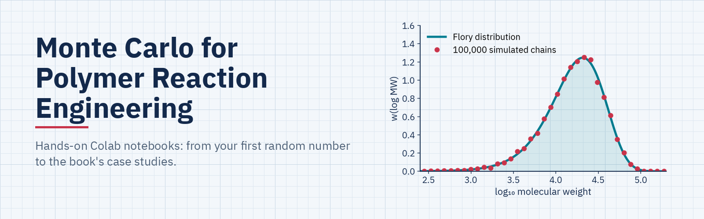

# Monte Carlo for Polymer Reaction Engineering

Hands-on Colab notebooks that teach Monte Carlo simulation from scratch, then apply it to polymer reaction engineering. No prior Monte Carlo experience needed.

Companion to the book **Monte Carlo Methods in Polymer Reaction Engineering: From Mechanisms to Molecular Architecture** (J. B. P. Soares, M. Al-Khayyat, A. L. T. Brandão, 2026). The notebooks focus on running and visualizing the algorithms.

Two families of models are covered, following the book:
- **Steady state Monte Carlo** (Ch. 3): event probabilities are constant, so chains are built one after another.
- **Dynamic Monte Carlo** (Ch. 4, Gillespie's method): reaction rates change with time, so every event is followed on a clock.

## Notebooks

| # | Topic | Type | What you'll do | Run |
|---|---|---|---|---|
| 1 | **Monte Carlo warm-up** | basics | Random numbers, waiting times, and a full Monte Carlo decision tree (reactor with recycle) | [](https://colab.research.google.com/github/MohammedAlkhayyat/MonteCarloPolymerReactionEngineering/blob/main/01_Monte_Carlo_Warmup.ipynb) |
| 2 | **Chain growth & MWD** | steady state | Build chains one by one; n-CLD, w-CLD and log-scale MWD; combination vs transfer | [](https://colab.research.google.com/github/MohammedAlkhayyat/MonteCarloPolymerReactionEngineering/blob/main/02_Chain_Growth_MWD.ipynb) |
| 3 | **Copolymers & composition** | steady state | Bernoulli and terminal models, CCD, bivariate length × composition maps | [](https://colab.research.google.com/github/MohammedAlkhayyat/MonteCarloPolymerReactionEngineering/blob/main/03_Copolymers_Composition.ipynb) |
| 4 | **Long-chain branching** | steady state | Macromonomer pools, branch counting, linear / comb / hyperbranched chains | [](https://colab.research.google.com/github/MohammedAlkhayyat/MonteCarloPolymerReactionEngineering/blob/main/04_Long_Chain_Branching.ipynb) |
| 5 | **Step growth & gelation** | sequential + dynamic | AA + BB, Gillespie for step growth, AB + A₃, gel point with a disjoint-set (DSU) | [](https://colab.research.google.com/github/MohammedAlkhayyat/MonteCarloPolymerReactionEngineering/blob/main/05_Step_Growth_and_Gelation.ipynb) |
| 6 | **Dynamic MC: Gillespie's method** | dynamic | Microscopic rate constants, control volume, batch free-radical polymerization vs ODEs | [](https://colab.research.google.com/github/MohammedAlkhayyat/MonteCarloPolymerReactionEngineering/blob/main/06_Dynamic_MC_Gillespie.ipynb) |
| 7 | **Dynamic MC: ATRP & degradation** | dynamic | Simplified ATRP (persistent radical effect) and polymer degradation | [](https://colab.research.google.com/github/MohammedAlkhayyat/MonteCarloPolymerReactionEngineering/blob/main/07_Dynamic_MC_ATRP_and_Degradation.ipynb) |
| 8 | **Case Study 3.1: styrene FRP** | steady state | Reproduces Table 3.3 and Figs. 3.3–3.6 with the book's parameters | [](https://colab.research.google.com/github/MohammedAlkhayyat/MonteCarloPolymerReactionEngineering/blob/main/08_Case_Study_3-1_Styrene_FRP.ipynb) |
| 9 | **Case Study 3.2: styrene/MMA** | steady state | Reproduces Figs. 3.9, 3.10, 3.14 and 3.16 with the book's parameters | [](https://colab.research.google.com/github/MohammedAlkhayyat/MonteCarloPolymerReactionEngineering/blob/main/09_Case_Study_3-2_Styrene_MMA_Copolymerization.ipynb) |
| 10 | **Case study: control volume (Sec. 4.6)** | dynamic | Reproduces the event log and control-volume study (Tables 4.2–4.9, Figs. 4.10–4.11) | [](https://colab.research.google.com/github/MohammedAlkhayyat/MonteCarloPolymerReactionEngineering/blob/main/10_Case_Study_Dynamic_MC_Control_Volume.ipynb) |

Notebooks 1–7 teach the methods step by step; notebooks 8–10 reproduce case studies from the book with its parameters.

## How to run

**In the browser (recommended):** click an *Open in Colab* button, then **Runtime → Run all**. Nothing to install.

**Locally:**

```bash
pip install -r requirements.txt
jupyter notebook
```

Notebooks 1–7 run in a few seconds each. Notebooks 8–10 use [Numba](https://numba.pydata.org/) to compile the simulation loops and take about 20–60 seconds.

## License

Code: MIT. Text and figures: CC BY 4.0.

## How to cite

If you use these notebooks, please cite both the notebooks and the book. GitHub's **"Cite this repository"** button (right side of the repo page) gives ready-made APA and BibTeX for the notebooks.

**Notebooks**

```bibtex
@software{mc_pre_notebooks,
  author    = {Al-Khayyat, Mohammed},
  title     = {Monte Carlo for Polymer Reaction Engineering: Teaching Notebooks},
  version   = {1.0.0},
  year      = {2026},
  publisher = {Zenodo},
  doi       = {10.5281/zenodo.XXXXXXX},
  url       = {https://doi.org/10.5281/zenodo.XXXXXXX}
}
```

**Book**

```bibtex
@book{mc_pre_book,
  author    = {Soares, Jo{\~a}o B. P. and Al-Khayyat, Mohammed and Brand{\~a}o, Amanda L. T.},
  title     = {Monte Carlo Methods in Polymer Reaction Engineering: From Mechanisms to Molecular Architecture},
  publisher = {PUBLISHER},
  year      = {2026},
  isbn      = {978-...}
}
```
